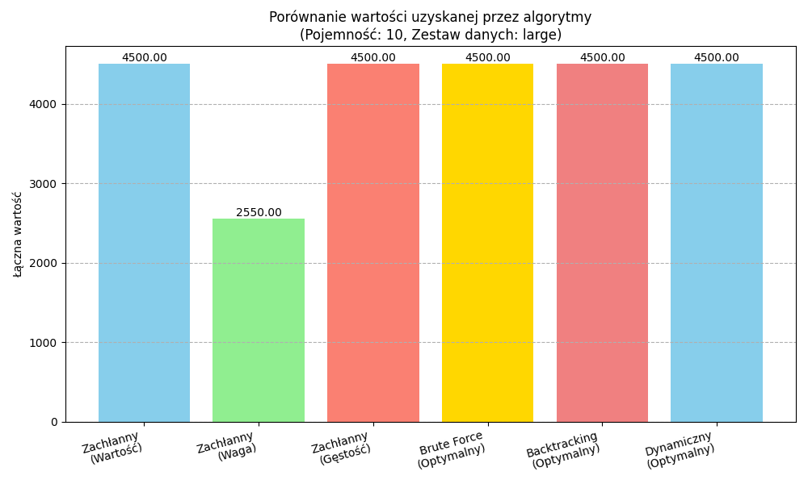

# Knapsack Problem Analyzer

An interactive Python project for comparing solutions to the **0/1 knapsack problem** and the **multiple knapsack problem**. Explore how solution quality and execution time change with the algorithm, item set, and capacity through a Streamlit interface or an interactive terminal program.

**Stack:** Python · Streamlit · NumPy · pandas · Matplotlib

## Features

- Compare greedy strategies, brute force, backtracking, and dynamic programming.
- Inspect total value, total weight, selected items, and execution time.
- Assign items to multiple knapsacks using backtracking, or use dynamic programming for exactly two knapsacks.
- Load bundled examples, upload a CSV in the web interface, or generate random item sets.
- Run scalability experiments by varying the number of items or knapsack capacity.
- View comparison charts and inspect stored experiment data in [analysis/results](analysis/results).

## Algorithms

| Method | Problem | Role |
| --- | --- | --- |
| Greedy by value, weight, or value-to-weight ratio | Single knapsack | Fast heuristics; the optimum is not guaranteed |
| Brute force | Single knapsack | Exhaustive reference solution for small inputs |
| Backtracking | Single or multiple knapsacks | Exact search with capacity checks |
| Dynamic programming | Single knapsack | Capacity-indexed exact optimization |
| Dynamic programming with a 3D table | Exactly two knapsacks | Joint optimization over both capacities |

Each item can be selected at most once. The DP implementations require integer weights and capacities. Start with **positive integer weights**, nonnegative values, and unique item IDs.

## Quick start

Use Python **3.10 or newer** in a virtual environment. Dependencies are pinned in [requirements.txt](requirements.txt).

```bash
git clone https://github.com/kapitanek23/knapsack-problem.git
cd knapsack-problem
python3 -m venv .venv
source .venv/bin/activate
python -m pip install -r requirements.txt
python -m streamlit run app_streamlit.py
```

On Windows PowerShell, create the environment with `python -m venv .venv` and activate with `.\.venv\Scripts\Activate.ps1`. Open the local URL printed by Streamlit, normally `http://localhost:8501`. The application interface is in Polish.

For a first comparison, select mode **01**, choose the **small** dataset, set capacity to **10**, and click **Uruchom Analizę**.

### Terminal interface

From the repository root, with the same environment active:

```bash
python main.py
```

Follow the prompts to choose `01`, `MKP`, or `SCALABILITY`, then select the data source and parameters. CLI scalability runs save JSON results under `analysis/results/`.

## Input format and example

CSV files use the columns `id,value,weight`. The bundled [example_items.csv](data/example_items.csv) contains:

```csv
id,value,weight
A,60,5
B,50,3
C,70,4
D,30,2
```

You can also call a solver directly:

```python
from algorithms.dynamic import dynamic_programming_knapsack
from utils import load_items_from_csv

items = load_items_from_csv("data/example_items.csv")
value, weight, selected = dynamic_programming_knapsack(items, capacity=10)

print(value)                              # 150.0
print(weight)                             # 9
print([item["id"] for item in selected])   # ['B', 'C', 'D']
```

Run this example from the repository root.

## Example visualization



The image is a stored experiment artifact. Runtime measurements depend on the input and machine; the repository does not record a complete benchmark environment or a fixed random seed.

## Project structure

| Path | Purpose |
| --- | --- |
| [app_streamlit.py](app_streamlit.py) | Interactive web interface |
| [main.py](main.py) | Interactive terminal interface and experiments |
| [algorithms/](algorithms) | Single and multiple knapsack solvers |
| [utils.py](utils.py) | CSV loading, example data, generation, and timing |
| [analysis/comparison.py](analysis/comparison.py) | Comparison and scalability plots |
| [data/](data) | Bundled CSV datasets |

## Scope and limitations

This is an educational algorithm comparison project. Exhaustive search and backtracking become expensive as the number of items grows; DP memory usage increases with capacity, especially for two knapsacks.

The CLI's single-knapsack chart call currently passes an obsolete `filename_prefix` argument and reports a plotting error after printing the solver results. Use the Streamlit interface for chart comparisons.

The repository includes runnable algorithm examples, but no automated test suite or CI workflow. Zero-weight items need additional care in single-knapsack DP solution reconstruction; use positive weights for comparisons.

## Author and feedback

Maintained by [Bartosz Kawalec](https://github.com/kapitanek23). Report reproducible problems through [GitHub Issues](https://github.com/kapitanek23/knapsack-problem/issues), including the input, algorithm, and expected result.

## License

No license file is currently included in this repository.
